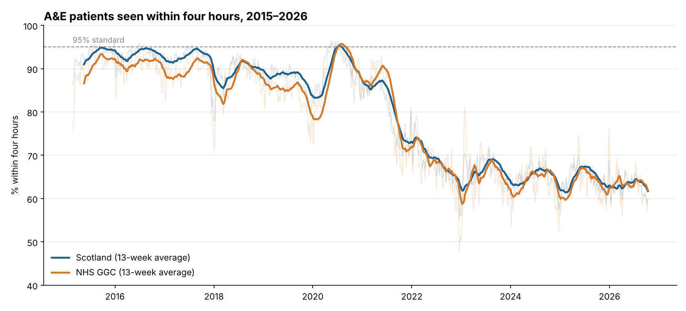
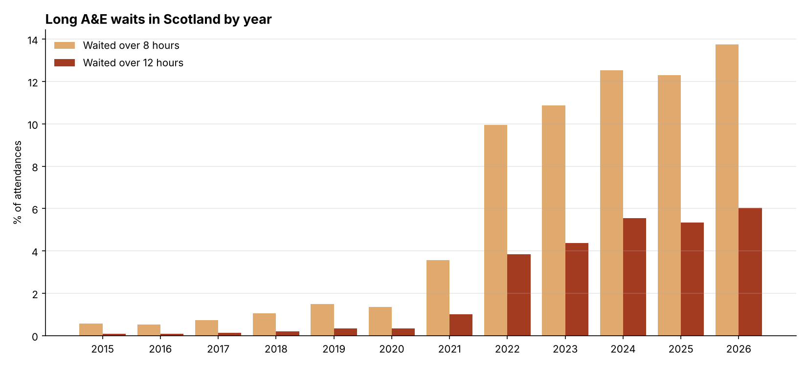
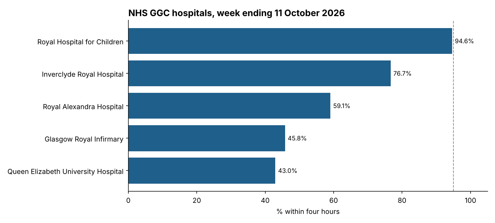

# NHS Scotland A&E Waiting Times: A Decade of Decline

An analysis of 11 years of weekly A&E data for Scotland and NHS Greater Glasgow and Clyde (GGC), covering 43,185 records from February 2015 to 11 October 2026. It includes data quality checks, a reproducible Python pipeline and an equivalent SQL analysis.

**Tools:** Python (pandas, matplotlib), SQL (SQLite)
**Data:** [Public Health Scotland, Weekly A&E Activity and Waiting Times](https://www.opendata.nhs.scot/dataset/weekly-accident-and-emergency-activity-and-waiting-times), Type 1 (major) emergency departments



## Key insights

**1. Performance dropped sharply in 2021–22 and has not recovered.**
From 2015 to 2019, 87–93% of patients in Scotland were seen within four hours each year. That fell to 67.5% in 2022, and every year since has been between 62% and 66%. In the week ending 11 October 2026, 59.7% of 29,261 patients were seen within four hours, against the Scottish Government standard of 95%. The best week in the last year was 68.7%.

| Year | Scotland | NHS GGC |
|---|---|---|
| 2015* | 93.3% | 90.3% |
| 2019 | 87.4% | 83.9% |
| 2021 | 80.1% | 81.0% |
| 2022 | 67.5% | 66.6% |
| 2024 | 64.7% | 63.8% |
| 2026* | 62.8% | 62.9% |

\*Part years: 2015 starts on 22 February; 2026 runs to 11 October.

**2. Very long waits have risen far more than the headline figure suggests.**
In 2015, fewer than 1 in 1,000 patients waited over 12 hours. In 2026 so far it is 6.0%, or about 1 in 17, which is **69,806 patients** in 41 weeks. Over-8-hour waits rose from 0.6% to 13.8%.



**3. The brief recovery in 2020 coincided with a collapse in attendances.**
Scotland met the 95% standard in 10 weeks of 2020. Weekly attendances in Scotland fell from about 26,400 at the start of March 2020 to about 11,000 by the end of the month, so the improvement reflects lower demand during the pandemic, not a change in capacity.

**4. Within GGC, the two largest adult hospitals perform worst.**
Over the last 13 weeks:

| Hospital | Attendances | Within 4 hours | Over 12 hours |
|---|---|---|---|
| Queen Elizabeth University Hospital | 27,240 | 46.0% | 7.2% |
| Glasgow Royal Infirmary | 22,561 | 52.5% | 4.0% |
| Royal Alexandra Hospital | 15,930 | 62.1% | 3.5% |
| Inverclyde Royal Hospital | 7,857 | 72.3% | 2.5% |
| Royal Hospital for Children | 19,033 | 91.2% | 0.0% |

The Royal Hospital for Children treats a different patient group, so it is not a like-for-like comparison with the adult sites.

**5. GGC used to lag Scotland, but no longer does.**
Before 2020, GGC was 1–4 points behind the national figure every year. Since 2021 the two have moved almost together, as performance across the rest of Scotland fell to GGC's level.



## Method

- **No double counting.** The source has three overlapping `AttendanceCategory` values: `All`, `Unplanned` and `New planned`. `All` already contains the other two, so only `All` rows are used in aggregates.
- **Ratios of sums.** Percentages are calculated as `100 × sum(within 4 hours) / sum(attendances)`, never as an average of site percentages. Averaging would give a small hospital the same weight as a large one.
- **Hospital names.** Treatment location codes are joined to names from the official [PHS hospital codes lookup](https://www.opendata.nhs.scot/dataset/hospital-codes), stored in `data/hospital_lookup.csv`.
- **Smoothing.** The long-term chart shows a 13-week rolling average over the faint weekly values, to separate the trend from week-to-week noise.

## Data quality checks

| Check | Rows flagged |
|---|---|
| Missing cells | 0 |
| Exact duplicate rows | 0 |
| Duplicate site-week-category keys | 2 |
| Within 4h > attendances | 0 |
| Within 4h + over 4h ≠ attendances | 0 |
| Over 8h > over 4h | 0 |
| Over 12h > over 8h | 0 |
| Negative counts | 0 |

**The duplicate keys:** both are G405H (Queen Elizabeth University Hospital) in the week ending 3 May 2015, with two `All` rows of 221 and 643 attendances. The rows have different values, so they are not copies. They fall around the time the hospital opened in 2015, when services were moving between Glasgow sites, so they may represent two reporting units sharing one code. This is an assumption I have not confirmed with PHS. Both rows are kept, because dropping either would undercount that week. The rows are saved in `results/duplicate_keys.csv`.

## Repository structure

```
├── analysis.py            # Full pipeline: checks, aggregates, charts, database
├── analysis.sql           # SQL version of the checks and analysis
├── requirements.txt
├── data/
│   ├── weekly_ae_activity_20261011.csv   # Source extract from PHS
│   └── hospital_lookup.csv               # Official PHS code-to-name lookup (GGC sites)
├── results/               # All CSV outputs (generated)
└── charts/                # All PNG charts (generated)
```

## How to run

```bash
pip install -r requirements.txt
python analysis.py
```

This regenerates everything in `results/` and `charts/` and builds `results/nhs_ae.db`. To use the SQL version, open that database in [DB Browser for SQLite](https://sqlitebrowser.org/) and run `analysis.sql`.

## Limitations

- Covers Type 1 (major) emergency departments only, not minor injury units.
- This is a single extract to 11 October 2026. Re-download the source for later weeks.
- Changes in service configuration over time, such as the opening of the Queen Elizabeth University Hospital in 2015, affect site-level comparisons.
- The analysis describes trends and does not establish their causes.
